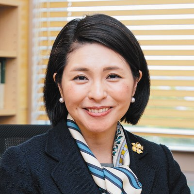
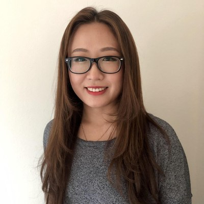
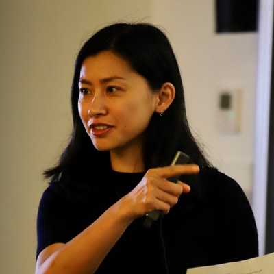
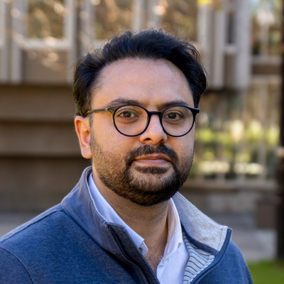
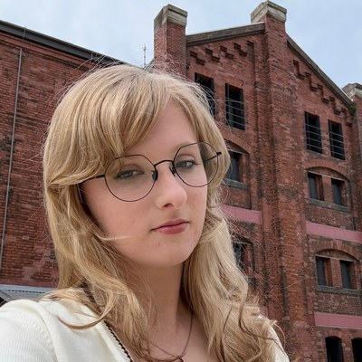
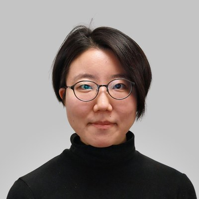
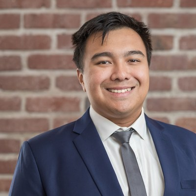
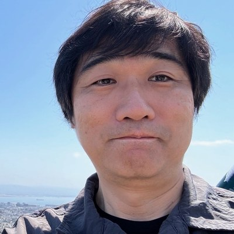
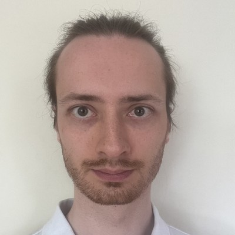

**A social science study of a generation working with AI**
{: .ai4s-lead}

## About the project

Artificial intelligence is rapidly changing how scientists learn and do research. The change goes beyond speed and efficiency: AI is reshaping how we think, communicate, and collaborate. As these tools become part of everyday research practice, now is a critical moment to look closely at the human experience that comes with this shift.
{: .ai4s-lead}

Our team brings physicists, social scientists, and data scientists together to study how physicists, and science more broadly, are changing as AI becomes part of everyday research. We work with researchers at the frontier of physics, astronomy, and related fields, examining how experienced scientists use AI on real, unsolved problems, and asking what that means for them and for science. 

The project is led by [Hiromi Yokoyama](https://member.ipmu.jp/hiromi.yokoyama/en/index.html){:target="_blank"}, [Shan Wang](https://www.usfca.edu/faculty/shan-wang){:target="_blank"}, and [Jia Liu](https://liuxx479.github.io/){:target="_blank"}.

## What we ask

- **Today and tomorrow.** How much do physicists use AI in their research now, what motivates that choice, and how do they expect their research style to change over the next one, five, and ten years?
- **Collaboration.** How does bringing AI into a team change the way scientists reason, solve problems, and work with each other?
- **Pressure.** How do researchers experience government expectations and international competition around AI in science?
- **Education.** How should we train the next generation of scientists in such a rapidly changing landscape?
- **Responsibility.** If AI can do part, or all, of a research project on its own, what is the value of the human researcher, and who is responsible for the result?
- **Identity.** What happens to ownership, meaning, and the joy of discovery when much of the work is produced by AI?

## Activities

### Workshop: Human–AI Collaboration in Advanced STEM

June 22–26, 2026 · Ito, Shizuoka, Japan · [Workshop page](/hac2026/)
{: .ai4s-activity}

A week-long workshop that brought together researchers from theoretical and experimental astrophysics, cosmology, high-energy physics, and materials science. After a morning of training on best practices for AI tools (prompting, verification, responsible use), participants formed small teams, chose unsolved problems matched to their combined expertise, and worked on them intensively while deliberately integrating AI into brainstorming, literature review, coding, and calculations. Each day began with a group briefing on research progress and AI use, and ended with a group interview led by our social science team. The interviews and observations from the workshop are the foundation of our ongoing analysis.

### Survey: the impact of AI on physics

Ongoing since August 2026 · International · Open to all physicists
{: .ai4s-activity}

Building on what we heard at the workshop, we are running a large-scale international survey of physicists. We want to collect your views on the current status and future of AI in physics research, and on how it may affect the education, responsibilities, and identities of scientists.

The survey is **anonymous and voluntary** and takes about **15 minutes**. No identifying or IP information is collected. Your perspective as a working researcher is exactly what this study needs. Please take part, and share it with your colleagues.

[Take the survey](https://usfca.qualtrics.com/jfe/form/SV_bxgGSBoMmj1ObEG){: .btn .btn--primary .btn--large target="_blank"}

## Team

  

    
    <h3><a href="https://member.ipmu.jp/hiromi.yokoyama/en/index.html" target="_blank">Hiromi Yokoyama</a></h3>
    
Co-Principal Investigator Kavli IPMU, The University of Tokyo

    
Dr. Hiromi Yokoyama is a Professor of Science and Technology Studies at the University of Tokyo and Kavli IPMU. With a PhD in physics, her research focuses on the relationship between science and society, including trust in science, AI and society, science communication, and women in STEM.

  

  

    
    <h3>Shan Wang</h3>
    
Co-Principal Investigator University of San Francisco

    
Dr. Shan Wang is an Associate Professor and previous director of Data Science and Artificial Intelligence at the University of San Francisco (on sabbatical at Kavli IPMU). Her research interests include medical informatics, biomedical research, and utilizing machine learning and AI to address social, ethical, and policy problems.

  

  

    
    <h3><a href="https://liuxx479.github.io/" target="_blank">Jia Liu</a></h3>
    
Co-Principal Investigator Kavli IPMU, The University of Tokyo

    
Dr. Jia Liu is an Associate Professor at Kavli IPMU and Director of the Center for Data-Driven Discovery (CD3). A computational and observational cosmologist, she studies the large-scale structure of the universe to learn about fundamental physics, including inflation, dark energy, and neutrino mass. She co-leads the project and brings the perspective of a working physicist using AI in daily research.

  

  

    
    <h3>Ehsan Nabavi</h3>
    
Australian National University

    
Dr. Ehsan Nabavi is a Senior Lecturer in Technology and Society at the Australian National Centre for the Public Awareness of Science at the Australian National University (ANU). He is the founder and head of ANU’s Responsible Innovation Lab, where he studies power, uncertainty, and diversity in sustainability and AI. His current research focuses on Responsible AI, with a particular interest in the responsible development and use of AI in science.

  

  

    
    <h3>Melody Benjamin</h3>
    
Kavli IPMU, The University of Tokyo

    
Melody Benjamin received an MA in Global Studies from Sophia University, specializing in sexual sociology, anthropology, and political science. Melody now works as an assistant researcher at Kavli IPMU as a qualitative data specialist.

  

  

    
    <h3>Reiko Naka</h3>
    
NORC at the University of Chicago

    
Reiko Naka recently completed her MA in Social Science at the University of Chicago and is starting work as a Research Associate at the National Opinion Research Center at the University of Chicago. Her research interests include gender disparities in STEM fields, organizational policy effects, and educational and institutional aspects of AI use for science.

  

  

    
    <h3>Yan Naing Aung</h3>
    
AI Engineer

    
Yan Naing Aung is an AI Engineer with an MS in Data Science and Engineering and an MS in Applied Economics from the University of San Francisco. His work focuses on developing Retrieval Augmented Generation (RAG) systems and multi-agent workflows, and he has contributed to developing evaluation frameworks for testing large language model reliability against adversarial prompts.

  

  

    
    <h3>Hui Zhang</h3>
    
Chinese Academy of Sciences / Kavli IPMU

    
Hui Zhang is a PhD student at the Institute of Psychology, Chinese Academy of Sciences. She is currently a one-year exchange researcher at Kavli IPMU, the University of Tokyo. Her research focuses on human–AI interaction, including human–machine trust, AI usage, and ethical AI design.

  

  

    
    <h3>Tomoharu Okada</h3>
    
NHK (Japan Broadcasting Corporation)

    
Tomoharu Okada is a Senior Program Director at NHK (Japan Broadcasting Corporation), where he has produced award-winning science documentaries on informatics and fundamental physics for nearly 30 years. He holds a Master of Arts and Sciences from the University of Tokyo, where he specialized in theoretical physics, including particle physics and superstring theory. His current research interests include the growing autonomy of AI systems in scientific practice, its ethical implications, and how expectations of AI are shaping the future of science.

  

  

    
    <h3>Marcin Korecki</h3>
    
Kavli IPMU, The University of Tokyo

    
Marcin Korecki is a postdoctoral researcher at the University of Tokyo. His research brings together AI, philosophy, social choice, and the study of complex adaptive systems to develop new ways of thinking about agency, value, and collective alignment in increasingly automated societies.

  

## Acknowledgments

This project is supported by **The Kavli Foundation**; by **JSPS KAKENHI** Grant Number JP25K21635, Grant-in-Aid for Challenging Research (Pioneering), "Establishing Global ELSI and RRI for the AI4S Era" (PI: Hiromi Yokoyama); and by a **JSPS Invitational Fellowship for Research in Japan** awarded to Shan Wang, hosted by Hiromi Yokoyama at Kavli IPMU.

We thank the participants of the 2026 workshop, everyone who has taken the survey, and the workshop and conference organizers who kindly helped us share it with their communities.

## Contact

Questions about the project or the survey: Shan Wang (swang151 /at/ usfca.edu) and Hiromi Yokoyama (hiromi.yokoyama /at/ ipmu.jp).
